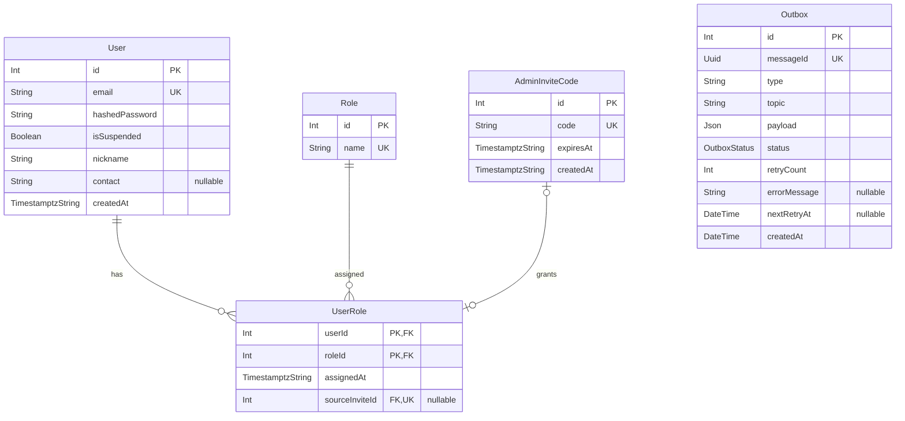

<!-- AI assistance (23/11/2026): codex -->
<!-- generation of first draft and removal of irrelevant items -->
# User service

Deno/Oak service for registration, JWT authentication, user profiles, and roles. Uses PostgreSQL through Prisma and RabbitMQ for user events and RPC.

## Project structure

```text
user-service/
|-- src/
|   |-- index.ts          # HTTP server, startup, and CLI entry point
|   |-- config.ts         # Environment and service settings
|   |-- log.ts            # Logging
|   |-- routes/           # Public/private HTTP routes
|   |-- controller/       # Request handling and validation schemas
|   |-- middleware/       # JWT authorization and request validation
|   |-- prisma/           # Schema, generated contract, repositories, role seed
|   |-- queue/            # RabbitMQ provider, RPC, and outbox workers
|   |-- redis/            # Redis connection and message deduplication lifecycle
|   |-- tasks/            # Admin invite CLI
|   `-- util/             # Passwords, JWTs, invite codes, and nicknames
|-- tests/                # Auth, users, middleware, outbox, and utility tests
|-- migrations/           # Prisma migrations and contract snapshots
|-- data/                 # Word list for generated nicknames
|-- prisma.config.ts      # Prisma contract and database configuration
|-- package.json          # Deno tasks and npm dependencies
|-- deno.json             # Deno imports and runtime configuration
`-- Dockerfile            # Development and production images
```

## First admin

Enter the running container from the repository root, then generate an invite:

```bash
docker compose exec user_dev sh
deno task admin:gen-invite
exit
```

The task prints a single-use code valid for 24 hours. Register and log in through `/public/auth/register` and `/public/auth/login` using an `email` and `password`. Then send `POST /public/auth/accept-invite` with JSON `{"code":"<printed code>"}` and `Authorization: Bearer <accessToken>`. Log in again or refresh the token to receive the admin role.

## API summary

Paths below are relative to the service (`http://localhost:8001` in Compose development). Protected endpoints use a bearer access token. Through the API gateway, add `/user` after `/public` or `/private`, e.g. `/public/user/auth/login`.

| Method | Path | Summary / access |
| --- | --- | --- |
| GET | `/public/health` | Health check; no authentication. |
| POST | `/public/auth/register` | Register with email/password; assigns requestor and courier roles. |
| POST | `/public/auth/login` | Exchange email/password for access and refresh tokens. |
| POST | `/public/auth/refresh` | Exchange a refresh token for a new token pair. |
| POST | `/public/auth/accept-invite` | Claim an admin invite; authenticated user. |
| GET | `/public/user/` | List users with name/role filters and cursor pagination; admin. |
| GET | `/public/user/:id` | Read a profile; self or admin. |
| PUT | `/public/user/:id` | Update nickname and contact; self or admin. |
| PATCH | `/public/user/:id/role` | Add/remove roles; admin, cannot change own admin role. |
| POST | `/public/user/:id/change-password` | Change password; self with existing password, or admin. |
| POST | `/public/user/:id/suspend` | Suspend a user; admin, cannot suspend own account. No body required. |
| DELETE | `/public/user/:id/suspend` | Unsuspend a user; admin. No body required. |
| GET | `/public/role/` | List available roles; admin. |
| POST | `/private/auth/invite` | Generate an admin invite; internal route with no bearer check. |

Login and refresh check the current database suspension status and reject suspended accounts with `403` and `{"error":"your account has been suspended"}` without issuing tokens. Login verifies credentials before reporting suspension. Token contents and authentication middleware retain their existing behavior.

Existing access tokens remain usable until they expire. The frontend clears stored tokens and returns to login when refresh is rejected, displaying the suspension message through the shared notification store. After unsuspension, the user can log in again.

## Database

Defined in [`src/prisma/contract.prisma`](src/prisma/contract.prisma). `UserRole` joins users and roles; its optional, unique `sourceInviteId` records a claimed admin invite. `Outbox` stores events awaiting publication to RabbitMQ (`PENDING`, `FAILED`, `COMPLETED`) and maps to table `outbox`.



## Outbox message identity

Each outbox row has a unique `messageId`, generated by PostgreSQL using `gen_random_uuid()`. The pinned Prisma release expresses this database default as `dbgenerated("gen_random_uuid()")`. The relay sends that persisted UUID as the AMQP `messageId` property on every publication attempt. Event JSON is unchanged. The integer `id` still identifies the database row; outbox `COMPLETED` means publication was confirmed, independently of each consumer's Redis status.

The additive `sync_outbox` migration connects the existing baseline to the previously untracked outbox schema. The following `outbox_message_id` migration adds the UUID column, fills existing rows, and enforces uniqueness. Apply with `deno task migrate`; local Compose development continues to use `db:update_dev`. No existing rows need to be deleted.

## Redis event deduplication

Compose starts Redis on `private_net` with a health check, AOF persistence, and `noeviction`. `REDIS_URL` defaults to `redis://redis:6379` in the user containers. For a service running outside Compose, point it at a reachable Redis URL. Redis has no published host port by default.

The event-consumer factory opens one Redis connection when initialized. Reuse the factory across delivery channels and close it after cancelling consumers and draining application handlers. Existing RPC workers do not initialize Redis or use event deduplication.

```ts
import { buildEventConsumers } from "./queue/impl/eventConsumer.ts";

const events = await buildEventConsumers();

// ch is the delivery channel passed to RabbitMqProvider's channel setup callback.
// Declare and bind the durable event queue before starting its consumer.
const consumer = events.create(ch, "my-service.user-registered", async (msg, signal) => {
    const payload = JSON.parse(msg.content.toString());
    signal.throwIfAborted();
    await handleUserRegistered(payload, signal);
});
const { consumerTag } = await consumer.start();

// During shutdown: cancel consumerTag on ch, drain handlers, then call events.close().
```

Use a stable logical consumer name, normally the queue name. Replicas use the same name; independent subscribers use different names. Redis keys are `message:<encoded-consumer>:<lowercase-messageId>`. Each record is a hash containing `status` and, while PENDING, an ownership `token`.

| State / outcome | Behavior |
| --- | --- |
| Missing record | Atomically claim PENDING with a fresh ownership token and a 60-second TTL, then run the handler. |
| PENDING | Skip execution, wait five seconds, and negatively acknowledge with requeue. |
| Handler running | Renew the owned lease every 20 seconds. A renewal failure or lost lease aborts the handler's signal. |
| Handler succeeds | Atomically change the owned record to COMPLETED with a 30-day TTL, then acknowledge. |
| COMPLETED duplicate | Acknowledge without executing or extending its TTL. |
| Handler fails | Release only its own PENDING record, then retry after five seconds. |
| Redis error / lost ownership | Withhold acknowledgement; leave uncertain records to expire and retry after backoff. |
| Missing / invalid message UUID | Reject without requeue. Configure a dead-letter exchange on the event queue if these messages must be retained. |

`RedisMessageLifecycle` accepts an injectable script client and exposes `claim`, `renew`, `complete`, and `release`. All state transitions use Lua scripts; stale owners cannot change a replacement lease or a completed record. `buildEventConsumers` accepts optional `pendingTtlMs`, `renewIntervalMs`, and `completedTtlMs`; `create` accepts `retryDelayMs` for individual guards.

This rollout adds the reusable guard within user-service. Its live consumers are RPC consumers, so adopting the guard in credit-service and other event consumers is deferred. A handler must honor cancellation where possible and keep business side effects idempotent: Redis cannot atomically commit a database transaction and its completion record. Crashes between those writes, lease loss, Redis data loss, or redelivery after 30 days can allow execution again.

## Validation

For manual validation in a functional environment, run these commands from this directory:

```bash
deno install
deno task check
deno task test
```

The normal test suite includes outbox UUID propagation, AMQP header compatibility, event-consumer settlement and lease behavior, and migration backfill checks on an embedded PostgreSQL engine. To apply the schema against a configured database, run `deno task migrate`, then `deno task db:verify`. These commands are manual follow-up steps; the implementation has not been run against live services.

The integration tests are skipped unless `TEST_REDIS_URL` is set; the RabbitMQ test also requires `TEST_RABBITMQ_URL`. Supply reachable test instances and run `deno task test` again to exercise real Lua atomicity, TTL expiry, stale owners, and RabbitMQ duplicate deliveries. Integration tests use unique Redis prefixes and exclusive RabbitMQ queues, and remove their own records afterward. They do not flush shared Redis data or modify production consumers. For integration tests inside Compose, use `redis://redis:6379` and the internal broker URL; host-based tests need separately reachable Redis and RabbitMQ addresses.
